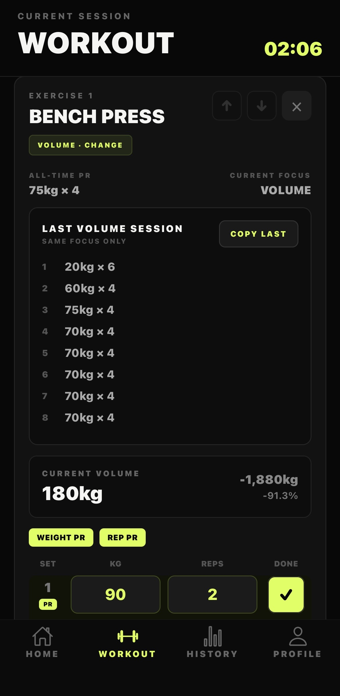
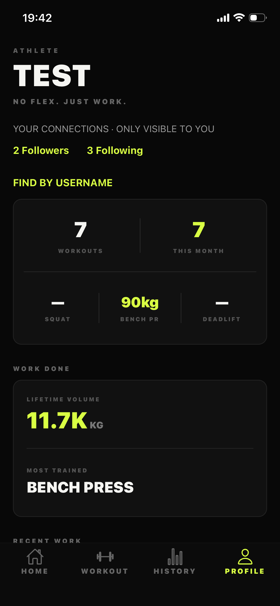
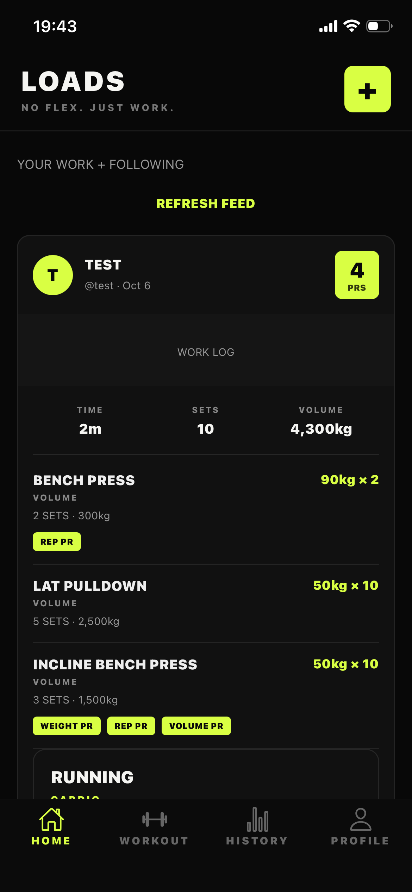
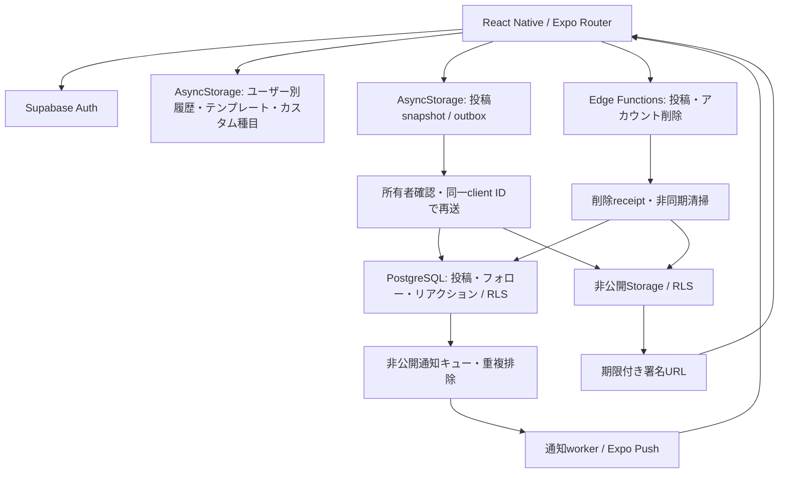

# LOADS

**No flex, just work.**

LOADSは、筋力トレーニングを続ける人が前回の記録を参照し、ワークアウトと写真を仲間に共有できるモバイルSNSです。企画・設計・実装・テスト・iOS配布準備まで個人で開発しています。既存の配布記録では、TestFlightを通じて友人8名に利用してもらい、実機でのフィードバックを集めています。App Store一般公開はしていません。

本READMEは**2026-10-21のローカル実装**に基づきます。最新ソースの機能がすべてTestFlight配布済みであるとは扱いません。

## 1. プロジェクト概要

トレーニング中の入力、前回セットの参照・コピー、終了後の保存と共有を一つの流れにまとめました。通信が失敗しても端末の記録を保持し、投稿は再送できる構成です。

「No flex, just work.」は、他人への誇示より、実際に取り組んだ記録を大切にする設計思想です。他人との順位比較やSNSへの依存を煽ることを目的にせず、自己の過去記録と、知っている仲間の取り組みを中心にしています。リアクションも人気投票にしないため、他人のリアクション一覧・件数を公開しない設計です。

## 2. 開発背景と課題

筋トレ仲間との「既存の筋トレアプリは、実際にトレーニングする人が欲しいものとズレている」という会話が開発のきっかけです。前回のセットを確認しながら入力し、終わったら共有する体験を目指しました。

継続利用には、入力のしやすさだけでなく、通信失敗時の記録保持、意味の異なる負荷を比較しないPR判定、アカウント切替時のデータ分離が必要です。機能追加と並行して、保存・認可・再試行の境界を設計し、回帰テストを追加しています。

## 3. スクリーンショット

既存の紹介画像です。最新のPR v2・カスタム種目管理・リアクションUIをすべて反映した画像ではありません。

| Workout | Profile | Feed |
| --- | --- | --- |
|  |  |  |

## 4. 主な機能

「実装」は現行ソースとローカルテストで確認した範囲です。実機配信・運用確認とは区別しています。

| 領域 | 実装内容・制約 |
| --- | --- |
| ワークアウト | 種目選択・順序変更、重量・回数・セット結果・メモ、前回の同じfocusの記録参照・コピー、履歴・テキストコピー |
| PR判定v2 | 重量・同重量での反復数・VOLUMEモードのボリューム更新を判定。初回はFIRST RECORDとして基準を確立し、PR件数に含めない |
| 懸垂の分類 | ASSISTED / BODYWEIGHT / WEIGHTEDを分離。補助は重量減少、自重は回数、加重は追加重量を評価。自重・補助はボリューム集計対象外 |
| カスタム種目 | 名前・部位・器具・記録方式を指定して作成、編集、アーカイブ・復元。ユーザー別の端末保存。記録方式は作成後変更不可 |
| テンプレート | 種目・focus等を保存・再利用・削除。重量・回数は引き継がない |
| 有酸素運動 | 時間、種目別の距離・速度・傾斜等を記録。筋トレとの混在、履歴・投稿表示に対応 |
| SNS | ワークアウト投稿、任意の写真・キャプション、本人とフォロー先のFeed、ユーザー名完全一致検索、フォロー・解除、仲間タグ |
| リアクション | 他人の閲覧可能な投稿に4種類から1つを選択・変更・取消。旧8種類の保存値を読取可能。自分の選択のみ取得し、公開件数・一覧を持たない |
| 通知 | ワークアウト完了・仲間タグ・リアクションのPush処理、通知設定、端末登録、通知先の認可確認。リアクション通知は初期OFF |
| 認証・削除 | メール確認、セッション永続化、ログアウト、ユーザー別端末データ分離、本人投稿削除、パスワード再確認を伴うアカウント削除 |
| 信頼性 | 投稿outboxと同じclient IDによる再送・重複防止、非公開画像と署名URL、削除receiptと非同期清掃 |

**現在の制約：** `loadType`付き種目（分類済み懸垂および該当するカスタム種目）を含むワークアウトの新規投稿は、旧クライアントで負荷を誤表示することを避けるため停止しています。端末保存・履歴・テキストコピーは利用できます。通常種目や既存送信待ち投稿とは処理を分けています。

履歴・テンプレート・カスタム種目は端末内保存で、クラウド投稿とは別データです。端末間同期はありません。リアクションPushの実機配送と通知タップ後の遷移は今回未検証です。

## 5. 使用技術

以下は`package-lock.json`に記録された解決済みバージョンです。

| 分類 | 技術・バージョン | 用途 |
| --- | --- | --- |
| アプリ | Expo 57.0.24 / React Native 0.86.3 / React 19.2.3 | モバイルUIと端末機能 |
| 画面遷移・型 | Expo Router 57.0.22 / TypeScript 6.0.3 | ファイルベースルーティング・strict型検査 |
| Backend | Supabase JS 2.117.1 / PostgreSQL / Auth / Storage / Edge Functions | 認証、投稿、認可、画像、非同期処理 |
| 端末保存 | AsyncStorage 2.2.0 | ユーザー別履歴・テンプレート・outbox等 |
| 写真・通知 | Expo Image Picker / Image Manipulator / File System / Notifications | 写真選択・処理、端末登録・Push |
| 品質管理 | ESLint 9.39.5 / Node.js test runner / PGlite 0.5.8 | 静的検査・ロジック・SQL回帰テスト |
| 配布 | EAS Build / Submit、TestFlight | iOSビルド・外部テスト |

依存宣言は[package.json](package.json)、固定された依存は[package-lock.json](package-lock.json)を参照してください。アプリ表示バージョンは`app.json`の1.1.0で、内部packageバージョン1.0.0とは異なります。

## 6. システム構成



端末記録を主とし、共有時にsnapshotをクラウドへ送ります。画面上の制限に加え、DB・Storage側のRLSで所有者・フォロー関係等を確認します。通知の外部通信は記録保存から分離しています。

```text
src/app/             画面・レイアウト（Expo Router）
src/components/      入力・投稿・認証状態・リアクションUI
src/hooks/           所有者・プロフィール・Feed等の状態管理
src/lib/             記録・PR・カスタム種目・投稿・認証・通知
supabase/migrations/ テーブル・RLS・RPC・トリガー
supabase/functions/  削除・清掃・通知worker
tests/               Node.js / PGliteの回帰テスト
docs/                設計・検証記録（各資料に確認時点を記載）
```

## 7. 技術的に工夫した点

### 記録の意味を壊さないPR判定と互換性

初回記録をすべてPRとすると、自己記録の更新と基準の作成が混ざります。[pr.ts](src/lib/pr.ts)で判定を共通化し、v2では有効な完了セットだけを比較し、FIRST RECORDをPRから分離しました。未経験の重量で単に反復した場合もREP PRにはしません。

懸垂は補助重量と追加重量で改善の方向が逆になるため、分類ごとに比較履歴を分けています。旧記録はv1として保持し、過去の投稿snapshotを再計算しません。分類付き投稿の停止も、表示互換性を優先した判断です。

### 種目名の編集と過去記録の整合性

名前を比較キーにすると、名称変更でPR履歴が途切れます。[customExercises.ts](src/lib/customExercises.ts)では永続的な`exerciseKey`を使い、記録には当時の情報を保持します。記録方式の変更は禁止し、不要な種目は削除せずアーカイブすることで、再利用と過去記録の保全を両立しています。保存処理はユーザー別に直列化します。

### 通信失敗・応答喪失に耐える投稿

画像アップロードと投稿INSERTを一度に完了できないため、[postOutbox.ts](src/lib/postOutbox.ts)に投稿前のsnapshotを保存します。[cloudPosts.ts](src/lib/cloudPosts.ts)では同じclient ID・画像パスで再送し、DBの`(user_id, client_post_id)`一意制約と既存行確認を組み合わせ、応答喪失後も既存投稿へ収束させます。

### 比較を煽らず、再試行できるリアクション

[reactionApi.ts](src/lib/reactionApi.ts)は「トグル要求」ではなく希望する最終状態を保存します。連打を抑制し、失敗時は保存済み状態を読み直して、応答だけ失われたケースにも対応します。Feed単位でまとめて初期取得し、カードごとの追加リクエストを避けています。

他人のリアクションをクライアントへ公開しないRLSと、投稿者への任意の通知を組み合わせています。人気の数値比較を持ち込まず、仲間への反応を残すための設計です。

### 通知の重複抑制と保存処理の分離

リアクションは投稿と送信者の組を非公開イベントとして保持し、変更・取消・再作成でも通知を増殖させません。通知設定は登録時とclaim時に検査し、初期OFFからONにしても過去分を遡及送信しません。キュー登録の失敗がリアクション保存を取り消さない構造です。

[push worker](supabase/functions/_shared/push.ts)は送信・receiptの状態を管理します。配送結果が不明な場合は`uncertain`として扱い、安易な再送を避けます。外部Pushサービスを含む配送全体の「必ず1回」を保証するものではありません。

### アカウント分離と途中失敗からの復旧

[userLocalData.ts](src/lib/userLocalData.ts)でユーザー別の保存キー・書込み直列化・所有者確認を使い、ログアウト前に処理を待ちます。Auth・DB・Storage・端末を跨ぐ削除にはreceipt・tombstone・清掃workerを使い、未確認の応答を完了扱いにしません。[accountDeletion.ts](src/lib/accountDeletion.ts)

### 視認性とReact Compiler下の表示更新

補助ラベルの色・サイズ、focusの説明、セット結果の表示を改善し、対象ラベルのコントラストを回帰テストで検査しています。リアクションでは、可変controllerの同一参照によってCompilerが表示を再利用する不具合をローカルで再現し、新しいstate snapshotをReactへ渡す形に修正しました。開発・productionの両Compiler変換を通した操作テストを追加しています。ネイティブのタッチ認識自体は別途実機確認が必要です。

## 8. テスト・品質管理

2026-10-21、現在のローカル作業ツリーで実行しました。

| コマンド | 結果 |
| --- | --- |
| `npm run typecheck` | 成功 |
| `npm run lint` | 成功 |
| `npm test` | 57テストファイル、259件成功・失敗0・スキップ0 |
| `npx --no-install tsc -p supabase/functions/tsconfig.json` | 成功（アプリとは別の型検査） |

PR v1/v2、FIRST RECORD、カスタム種目、投稿再送、アカウント分離・削除、リアクション操作・通知設定・重複抑制、RLS・RPC・CASCADE等を検証しています。Node.js runnerに加え、PGliteの隔離DBへSQLを適用し、workerにはモックtransportを接続して通知ロジックを検査します。本番データへの書込みや実Pushは行っていません。

モック・ソース構造検査・Compiler変換後のUIハーネスも含み、実機E2Eとは異なります。PGliteは実SupabaseのAuth/JWT、PostgREST、複数接続のロック競合、Edge Runtime、APNsを代替しません。また1件はGit除外済みのローカル検証SQLが存在するときのみ実行され、クリーンcheckoutではスキップされる構成です。

### 開発環境

```bash
npm ci
# .env.exampleを.envへコピーし、自身のSupabaseの公開設定を入力
npm start
npm run typecheck
npm run lint
npm test
```

`EXPO_PUBLIC_SUPABASE_URL`と`EXPO_PUBLIC_SUPABASE_KEY`には自身のプロジェクトの公開設定を使います。[publishable / legacy anonキー](https://supabase.com/docs/guides/api/api-keys)は秘密鍵と区別し、データ保護は認証・権限・RLSで行います。service_role / secretキー、審査用パスワード、署名鍵はクライアントやGitへ入れません。

基礎profiles等を含む空のSupabaseへの一括bootstrapは未検証です。SQLを既存本番環境へ無条件に再適用しないでください。写真・Pushの実機検証には対応するネイティブビルドと設定が必要です。

## 9. 配布・運用状況

TestFlightによる友人8名への外部テスト・フィードバック収集は既存READMEの利用実績です。開発では視認性や操作性の見直し、PRの意味の整理、リアクションの表示更新不具合などを改善しています。ただし、個々の変更とテスターの指摘の対応、最新ビルドの配布人数・ソースSHAは記録だけでは確定できないため、検証済み実績として追加していません。

リアクション関連のDB・workerの反映について既存の運用記録はありますが、今回リモート環境は再確認していません。最新クライアントとの実機統合・Push配送・通知遷移を完了済みとは扱いません。App Store一般公開・公開配布リンクの掲載はしていません。

## 10. 今後の改善課題

- 分類付き投稿を安全に再開するためのクライアント互換性・利用バージョンの確認。
- 独立したSupabase検証環境でのJWT・REST認可・並行処理、複数端末でのPush・通知遷移・回線切断試験。
- 最新UIの紹介画像更新、TestFlightのビルド番号・ソースSHA・指摘・修正・再確認結果の対応記録。
- クリーンcheckoutでも再現できるテストfixture、CI、空環境のbootstrap手順の整備。
- 大きくなった[workout.tsx](src/app/workout.tsx)の入力・比較・保存・表示責務の分割。既存記録と回帰テストを保ちながら段階的に進める。
- 端末内データのバックアップ・端末間同期、文字拡大・アクセシビリティとAndroid実機での検証。
